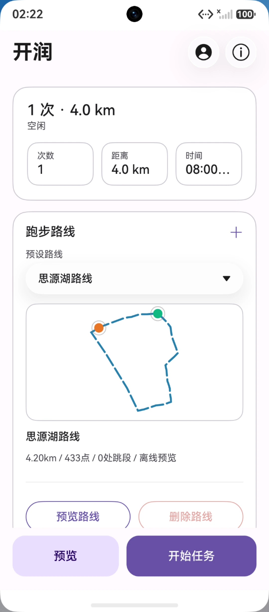

# HarmonyOS NEXT Guide

Version **`4.5.0`**, bundle name `com.sjtu.runner` (`apps/harmonyos/AppScope/app.json5`). Project path: `apps/harmonyos/`.

> Features are aligned with the Android build: parameter ranges, task flow, route preview, status statistics, run logs and the update checker are all re-implemented natively in ArkTS/ArkUI (HDS components + immersive material) with no shared code. Only the install procedure, system permissions and login entry point differ.



## Contents

- [1. Installing the HAP](#1-installing-the-hap)
- [2. Login](#2-login)
- [3. Parameters](#3-parameters)
- [4. Starting an upload](#4-starting-an-upload)
- [5. Custom routes](#5-custom-routes)
- [6. Permissions](#6-permissions)
- [7. Differences from other platforms](#7-differences-from-other-platforms)
- [8. Known ArkTS toolchain traps](#8-known-arkts-toolchain-traps)

## 1. Installing the HAP

> ⚠️ **Complete Huawei developer verification first** to extend the debug certificate validity. Without it the debug certificate expires quickly and you must reinstall.

1. Download the HAP from [Releases](https://github.com/JackyTJie/SJTURunningMan_Advanced_Edition/releases).
2. On the phone: **Settings → About → tap "Software version" 7 times**, restart, and developer options are enabled.
3. Go to **Settings → System → Developer options → Wireless debugging**, enable it and note the IP and port.
4. Connect the PC and phone to the same network, download [小白调试助手](https://github.com/likuai2010/auto-installer) and run it, following its on-screen instructions.

## 2. Login

1. On first launch a **commitment notice** appears; tick the box and tap "我承诺，进入软件". Tapping "退出" terminates the app. Acceptance is stored in `app_prefs/commitment_accepted` and the notice is not shown again.
2. Open the **Account** tab and tap **JAccount 账号** to reach the login page.
3. The page returns automatically when loading finishes; the status card then reads "已登录". If the cookie expires the app re-opens the login page.

> ⚠️ HarmonyOS **cannot** launch the one-tap "交我办" login — web login only. If "交我办" is installed the login page tries to launch it; otherwise it tells you and stays on the web page.

## 3. Parameters

The "开润" tab shows the status card, the route card, the task settings cards and the run log, from top to bottom.

| Parameter | Range | Default | Notes |
| --- | --- | --- | --- |
| Runs | 1–30 | 1 | Choose 1/3/5/7/10/15/30 or "自定义" to type a number |
| Start time | hour 0–23 / minute 0–59 / second 0–59 (i.e. 00:00:00–23:59:59) | 08:00:00 | Each record gets a random **±10 min / ±30 s** jitter |
| End date | Date picker | Yesterday | Records are generated backwards from this date |
| Distance | 1–5 km | 4 km | Per-record target distance, slider step 0.1 km |
| Route | See below | 思源湖路线 | Dropdown; design a new one on a separate page |

Ranges come from `apps/harmonyos/entry/src/main/ets/config/AppConfig.ets`.

## 4. Starting an upload

1. Tap **开始任务** in the bottom action bar.
2. The status card shows the current stage (准备中 / 获取认证 / 生成数据 / 上传中 / 正在停止 / 已完成 / 失败) and a progress bar.
3. **预览路线** generates one track offline from the current settings and shows distance / point count / jump count plus a scatter canvas.
4. When finished the log reports "任务完成: 成功 N 条，失败 M 条". **清空** clears the log (capped at 400 entries).

If the selected route is longer than the target distance, a "路线距离提醒" dialog offers **削减路线** (truncate to the target) or **取消任务**; choosing the full route runs the whole route and syncs the target distance.

While a task is running you can tap **停止任务** to abort it. The stop takes effect at the next loop boundary; if an upload is already in flight, the task ends once that request returns (read timeout 20 s at most) and the UI never freezes.

## 5. Custom routes

1. On the route design page, **tap points in order** on the map.
2. More points fit the road better; **order matters, and the first and last points should be close together**.
3. After saving, pick the new route in the main-screen dropdown. Non-built-in routes can be removed with **删除路线**.

Coordinate format and coordinate-system differences: [routes.md](./routes.md).

## 6. Permissions

Declared in `apps/harmonyos/entry/src/main/module.json5`:

| Permission | Purpose |
| --- | --- |
| `ohos.permission.INTERNET` | Upload data to pe.sjtu.edu.cn, check for updates |
| `ohos.permission.GET_NETWORK_INFO` | Detect network availability |

HarmonyOS **does not read location or phone state**: tracks are interpolated offline from the selected route and upload coordinates are the route coordinates plus a fixed offset, exactly as on Android.

## 7. Differences from other platforms

| Item | Android | HarmonyOS |
| --- | --- | --- |
| Install | APK | HAP + debug certificate (limited validity) |
| One-tap login | Yes | No, JAccount web login only |
| Permissions | INTERNET / ACCESS_NETWORK_STATE / READ_PHONE_STATE | INTERNET / GET_NETWORK_INFO |
| Parameters | 1–30 runs / 1–5 km | Same as Android |
| UI toolkit | Material 3 (Compose) | HarmonyOS Design components + immersive material |
| Route asset | `route_design.html` (Baidu Maps) | Same asset, stored separately (the bridge object is still named `AndroidInterface`) |
| About / updates | Dialog | Dedicated "About" page |
| Route preview colours | Material theme colours | Fixed blue/orange palette matching the map (`RoutePreviewCanvas.ets`) |
| Automated tests | JVM unit tests | None yet |

Building and packaging: [build.md](./build.md). Coordinate systems: [routes.md](./routes.md).

## 8. Known ArkTS toolchain traps

These compile fine and only fail at runtime on a device, so keep them in mind when changing the UI.

**Never put a custom component directly inside an arrow function passed to an external component.** The ArkTS
compiler only rewrites `Foo({...})` into `new Foo(this, {...})` when the call sits in a declarative-UI context.
Written as an arrow-function property of an object — for example
`new SuffixCustomBuilder((): void => { DistanceSlider({...}) })` — the call is not rewritten, and evaluating the
closure throws `TypeError: class constructor cannot called without 'new'`, crashing the app. Put the component in
an `@Builder` method and call that method from the closure instead:

```typescript
@Builder
DistanceSliderBuilder() {
  DistanceSlider({ /* ... */ })
}

// suffixItem: new SuffixCustomBuilder((): void => { this.DistanceSliderBuilder() })
```

> To verify: after building, inspect the intermediate `.ts` files under
> `entry/build/default/cache/default/default@CompileArkTS/esmodule/debug/` and confirm the component became
> `new Foo(this, {...})`. A bare `Foo({...})` call there will always crash.
