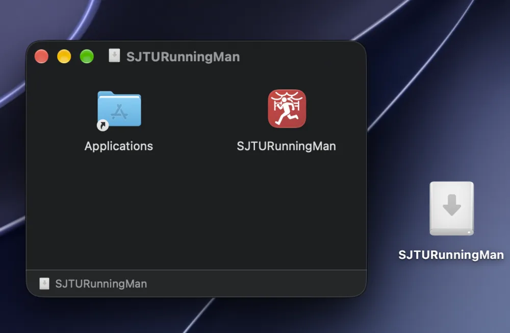
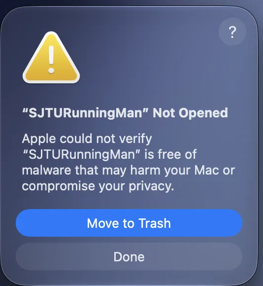
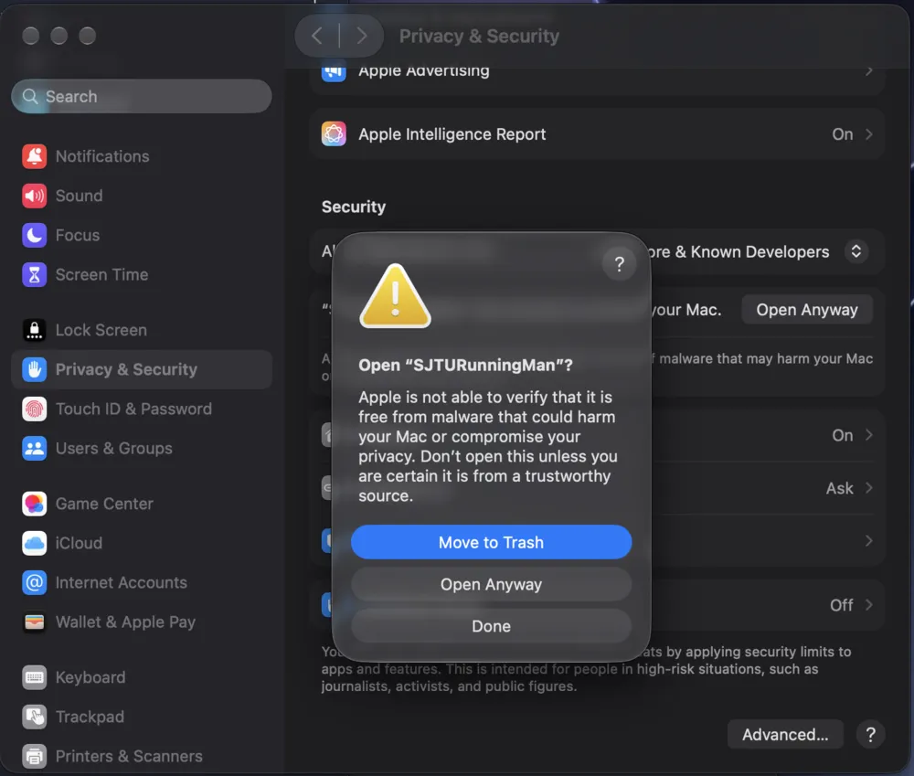

# macOS Guide

The macOS side of the desktop build. Functionality is identical to Windows — only the **install steps** and **how to get past the first-launch block** differ.

For shared behaviour (parameters, route preview, upload flow, data generation) see [desktop.md](./desktop.md); it is not repeated here.

## Requirements

| Item | Requirement |
| --- | --- |
| macOS | **14 (Sonoma) or later** |
| Architecture | One universal build covers both Apple Silicon and Intel |

> ⚠️ The minimum macOS version is set by PySide6. From PySide6 6.12 onward the official wheel's deployment target moved from `macosx_13_0` to `macosx_14_0`, so this project (PySide6 ≥ 6.12) requires **macOS 14+**. On macOS 13 or earlier, use an older release.

## Install

1. Download `SJTURunningMan-<version>-macOS-universal.dmg` from [Releases](https://github.com/JackyTJie/SJTURunningMan_Advanced_Edition/releases).
2. Double-click to mount it, then drag **SJTURunningMan.app** into **Applications**.



3. Eject the disk image (click ⏏ next to its name in the Finder sidebar).

## First launch: getting past Gatekeeper

The app is not signed or notarized by Apple, so macOS blocks the first launch. **This is expected and does not mean the file is broken.**

### What you'll see

Double-clicking the app shows:

> **"SJTURunningMan" Not Opened**
> Apple could not verify "SJTURunningMan" is free of malware that may harm your Mac or compromise your privacy.



The dialog offers **only "Move to Trash" and "Done"** — there is no allow button. That changed in macOS 15: the allow flow moved into System Settings.

### What to do

1. Click **Done** (**not** Move to Trash — that deletes the app).
2. Open **System Settings → Privacy & Security** and scroll to the **Security** section.
3. There will be a notice about `SJTURunningMan`; click **Open Anyway** on the right.



4. Confirm once more; enter your password or use Touch ID.

After allowing it once, the app opens normally from then on.

### If no notice appears in System Settings

Double-click the app **again** to trigger the block — only then does the entry show up under Privacy & Security.

If it still doesn't, **Control-click** (or right-click) the app in Finder, choose **Open**, then click **Open** in the dialog. This path also works on older macOS versions.

### Still blocked: remove the quarantine attribute

Files downloaded from the internet carry a `com.apple.quarantine` attribute. The steps above essentially ask the system to clear it; you can also do it directly:

```bash
xattr -d com.apple.quarantine /Applications/SJTURunningMan.app
```

> This strips the quarantine flag from that app. Only do it for software whose origin you have verified yourself.

## Uninstall

1. Drag `/Applications/SJTURunningMan.app` to the Trash.
2. The app is portable; its state lives in the `Routes/` folder next to it and in temp directories. To be thorough:

```bash
ls ~/Library/Application\ Support/ | grep -i sjtu
ls ~/Library/Preferences/ | grep -i sjtu
```

Delete anything left over.

## Running from source

The same as Windows — see [build.md](./build.md#desktop):

```bash
python -m venv .venv
source .venv/bin/activate
pip install -r requirements.txt
python qtui.py
```

Packaging:

```bash
python -m PyInstaller --clean --noconfirm ./main.spec
```

On macOS `main.spec` produces a universal2 `.app` with the `assets/SJTURM.icns` icon.

## Troubleshooting

| Symptom | Fix |
| --- | --- |
| **"Apple could not verify…"** | See above: System Settings → Privacy & Security → Open Anyway |
| **"App is damaged" / Move to Trash** | The download is incomplete — download again; if it persists, use the `xattr -d` command above |
| **Asks for Rosetta** | It shouldn't. The universal build contains both architectures; if you're asked, you have an old build — download again |
| **Crashes on launch** | Confirm macOS 14+; check the crash log via Console (Applications → Utilities → Console), search for `SJTURunningMan` |
| **Generic icon** | Quit, remount the DMG and drag again; running the executable from `dist/` directly will not carry the icon |

Other functional issues: [faq.md](./faq.md).
